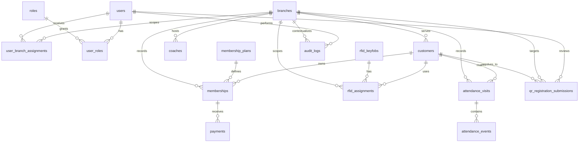

# GyTrak Database Schema Proposal

Status: discovery proposal only. This document does not implement a backend, migrations, persistence, or offline synchronization.

## Scope and evidence

This proposal is based on the current React prototype, especially:

- `src/contexts/GymDataContext.tsx`
- `src/types/index.ts`
- `src/data/mockData.ts`
- `src/contexts/AuthContext.tsx`
- `src/app/routes.tsx`
- Membership, walk-in, attendance, scanner, coach, RFID, administration, QR registration, dashboard, and report screens

The current application stores mock records in `localStorage`. `GymDataContext` now shares customers, registrations, walk-ins, visits, memberships, plans, payments, coaches, keyfobs, branches, Front Desk accounts, and audit rows. Authentication accounts are stored separately by `AuthContext`.

The relational model below separates durable business entities from display fields and dashboard aggregates. Names, labels, counts, formatted dates, and derived metrics should not be copied into every table unless they are intentionally retained as historical snapshots.

## Confirmed requirements versus recommendations

### Confirmed by the current application

- There are branches, Admin and Front Desk roles, and public branch-specific QR workflows.
- Front Desk access is assigned to a branch; Admin access is cross-branch.
- Customers can have memberships, walk-in records, visits, and optional keyfobs.
- Membership payments are entered manually and payment history is retained.
- A visit has separate time-in and time-out values, a source, a status, and scanner synchronization state.
- A duplicate open visit for the same customer and branch is rejected by the current check-in operation.
- QR profile submissions can be pending, returned for correction, approved, or rejected. Approval can link to an existing customer or create one.
- Coaches, branches, Front Desk accounts, and keyfobs are managed records.
- Audit rows need an actor, role, branch context, action, affected record, summary, and time.

### Recommendations requiring confirmation

- Use database-generated UUIDs (or another globally unique identifier) instead of display-oriented IDs such as `MEM-00814`.
- Represent branch access with assignment tables rather than a branch name string on an account.
- Treat a membership row as a membership term/period and create a new row for a renewal or plan change instead of overwriting history.
- Store UTC instants plus the branch timezone rather than formatted strings such as `Oct 20, 2026` or `09:42 AM`.
- Keep attendance events append-only and derive the logical visit's time-in/time-out state from them.
- Store audit event type, affected table/key, and structured metadata in addition to a human-readable summary.
- Keep dashboard totals derived from transactional tables; do not persist the current seed metrics as authoritative financial or attendance facts.

## Entity relationship overview

## Proposed tables

The SQL types below use PostgreSQL-style names for clarity. They are recommendations, not migrations.

### `branches`

Purpose: gyms or locations used for access scope and operational records.

| Column | Type | Required | Notes |
|---|---|---:|---|
| `id` | `uuid` | yes | Primary key. |
| `name` | `varchar(120)` | yes | Unique branch name, subject to confirmation. |
| `location` | `varchar(255)` | yes | Current display location. Could later be decomposed into address fields. |
| `status` | `varchar(20)` | yes | `active` or `inactive`. |
| `timezone` | `varchar(64)` | yes | Recommended; current prototype implicitly uses Philippine time. |
| `created_at` | `timestamptz` | yes | Creation timestamp. |
| `updated_at` | `timestamptz` | yes | Last administrative update. |

Primary key: `id`.

Constraints and indexes: unique index on normalized `name`; index on `status`. Do not store `customers`, `memberships`, `visits`, `revenue`, or `front_desk` counts as authoritative columns. Those are current seed/display aggregates.

### `users`, `roles`, `user_roles`, and `user_branch_assignments`

Purpose: authenticate staff and represent permissions separately from business records. The current `AuthAccount` combines identity, one role, one branch string, status, verification, and password hash.

#### `users`

| Column | Type | Required | Notes |
|---|---|---:|---|
| `id` | `uuid` | yes | Primary key. |
| `name` | `varchar(160)` | yes | Display name. |
| `email` | `citext` or normalized `varchar(320)` | yes | Unique login identifier. |
| `password_hash` | `varchar(255)` | yes for password auth | Never store a plaintext password. |
| `email_verified_at` | `timestamptz` | no | Nullable until verified. |
| `status` | `varchar(20)` | yes | `active` or `inactive`. |
| `created_at` / `updated_at` | `timestamptz` | yes | Account lifecycle. |

#### `roles`

| Column | Type | Required | Notes |
|---|---|---:|---|
| `id` | `smallint` or `uuid` | yes | Primary key. |
| `code` | `varchar(40)` | yes | Unique values such as `admin` and `front_desk`. |
| `name` | `varchar(80)` | yes | Display label. |

#### `user_roles`

| Column | Type | Required | Notes |
|---|---|---:|---|
| `user_id` | `uuid` | yes | FK to `users`. |
| `role_id` | `smallint` or `uuid` | yes | FK to `roles`. |
| `assigned_at` | `timestamptz` | yes | Assignment history start. |
| `revoked_at` | `timestamptz` | no | Null while active. |

Primary key: (`user_id`, `role_id`, `assigned_at`) or a generated assignment ID. Add a partial unique constraint so a user has at most one active assignment for a role if that is the rule.

#### `user_branch_assignments`

| Column | Type | Required | Notes |
|---|---|---:|---|
| `user_id` | `uuid` | yes | FK to `users`. |
| `branch_id` | `uuid` | yes | FK to `branches`. |
| `assigned_at` | `timestamptz` | yes | Assignment start. |
| `revoked_at` | `timestamptz` | no | Null while active. |

Primary key: (`user_id`, `branch_id`, `assigned_at`). Index active assignments by (`user_id`, `revoked_at`) and (`branch_id`, `revoked_at`). Current behavior is one assigned branch for Front Desk and all branches for Admin; the tables allow that rule to evolve without storing `"All branches"` as a fake branch.

### `customers`

Purpose: customer identity and branch association.

| Column | Type | Required | Notes |
|---|---|---:|---|
| `id` | `uuid` | yes | Primary key. |
| `branch_id` | `uuid` | yes | FK to `branches`; confirm whether customers may be associated with multiple branches. |
| `name` | `varchar(160)` | yes | Current profile name. |
| `phone_normalized` | `varchar(32)` | yes | Used by QR matching and walk-in check-in. |
| `phone_display` | `varchar(40)` | no | Optional formatted value. |
| `email` | `varchar(320)` | no | Current UI permits an email field; uniqueness is not assumed. |
| `customer_type` | `varchar(20)` | yes | Current values are `member` and `walk_in`; this may be derived from memberships rather than treated as identity. |
| `created_at` | `timestamptz` | yes | Replaces formatted `registered`. |
| `updated_at` | `timestamptz` | yes | Profile update time. |

Primary key: `id`. Index (`branch_id`), unique or non-unique index on `phone_normalized` depending on the confirmed identity rule. The current workflow permits multiple profiles with the same phone and reports an ambiguous match, so a global unique phone constraint would change existing behavior and should not be added without confirmation.

The current `status`, `plan`, `endDate`, `lastVisit`, and `keyfob` fields are denormalized summaries. Prefer deriving them from memberships, attendance, and RFID assignments, or retain them only as explicitly maintained snapshots.

### `coaches`

Purpose: coach records assigned to a branch.

| Column | Type | Required | Notes |
|---|---|---:|---|
| `id` | `uuid` | yes | Primary key. |
| `branch_id` | `uuid` | yes | FK to `branches`. |
| `name` | `varchar(160)` | yes | Display name. |
| `specialty` | `varchar(160)` | yes | Current required form field. |
| `phone` | `varchar(40)` | no | Current UI allows an empty value represented as `—`. |
| `status` | `varchar(20)` | yes | `active` or `inactive`. |
| `created_at` / `updated_at` | `timestamptz` | yes | Lifecycle. |

Primary key: `id`. Index (`branch_id`, `status`) and a search index on name if required.

### `membership_plans`

Purpose: reusable pricing and duration definitions.

| Column | Type | Required | Notes |
|---|---|---:|---|
| `id` | `uuid` | yes | Primary key. |
| `name` | `varchar(120)` | yes | Unique active plan name if names are global. |
| `duration_months` | `integer` | yes | Replaces strings such as `1 month` and `12 months`. Must be positive. |
| `price_minor` | `integer` or `bigint` | yes | Currency minor units, e.g. centavos; avoids floating-point money. |
| `currency` | `char(3)` | yes | Likely `PHP`; confirm if multi-currency is unnecessary. |
| `is_active` | `boolean` | yes | Controls new membership selection. |
| `created_at` / `updated_at` | `timestamptz` | yes | Lifecycle. |

Primary key: `id`. Unique index on normalized `name`; index `is_active`.

The current `used` count is a report metric and should be derived from memberships.

### `memberships`

Purpose: a customer's membership term at a branch and under a plan.

| Column | Type | Required | Notes |
|---|---|---:|---|
| `id` | `uuid` | yes | Primary key. |
| `customer_id` | `uuid` | yes | FK to `customers`. |
| `branch_id` | `uuid` | yes | FK to `branches`; preserves the branch context at creation. |
| `plan_id` | `uuid` | yes | FK to `membership_plans`. |
| `starts_at` | `date` | yes | Calendar date. |
| `ends_at` | `date` | yes | Calendar-month rules apply when calculated. |
| `status` | `varchar(20)` | yes | `active`, `pending`, `expired`, or `suspended`. |
| `created_at` / `updated_at` | `timestamptz` | yes | Lifecycle. |
| `renewed_from_id` | `uuid` | no | Self-FK if renewals become new term rows. |

Primary key: `id`. Foreign keys to customer, branch, plan, and optionally the previous membership. Index (`customer_id`, `ends_at`), (`branch_id`, `status`), and (`plan_id`). A check constraint requires `ends_at >= starts_at`.

The current UI stores `payment` and `price` on the membership. In the proposed model, payment state is derived from related payments, and the effective price is obtained from the plan or retained as an immutable `agreed_price_minor` snapshot when pricing history matters.

### `payments`

Purpose: manually recorded payment transactions and history.

| Column | Type | Required | Notes |
|---|---|---:|---|
| `id` | `uuid` | yes | Primary key; also the idempotency key for a client submission. |
| `membership_id` | `uuid` | yes | FK to `memberships` for current workflows. |
| `recorded_by_user_id` | `uuid` | yes in staff workflows | FK to `users`. |
| `amount_minor` | `integer` or `bigint` | yes | Positive money amount. |
| `currency` | `char(3)` | yes | Usually `PHP`. |
| `method` | `varchar(30)` | yes | Current values include cash, GCash, card, and bank transfer. |
| `reference` | `varchar(120)` | no | Receipt/POS/reference value. |
| `paid_at` | `timestamptz` | yes | Actual or recorded payment time; confirm distinction. |
| `status` | `varchar(20)` | yes | Recommended `recorded`, `voided`, or `refunded`; current UI only records successful manual payment. |
| `created_at` | `timestamptz` | yes | Insert time. |

Primary key: `id`. Index (`membership_id`, `paid_at`) and (`recorded_by_user_id`, `paid_at`). Optional unique constraint on (`method`, `reference`) when references are guaranteed unique.

The current workflows support multiple payment records per membership but do not expose partial-payment balance logic. Keeping one row per payment preserves history and allows multiple payments. If one transaction must allocate money across several memberships or invoices, introduce `payment_allocations` rather than changing `payments`.

### `rfid_keyfobs` and `rfid_assignments`

Purpose: retain the physical keyfob and its assignment history separately.

#### `rfid_keyfobs`

| Column | Type | Required | Notes |
|---|---|---:|---|
| `id` | `uuid` | yes | Primary key. |
| `uid` | `varchar(120)` | yes | Unique hardware identifier. |
| `status` | `varchar(20)` | yes | `available`, `deactivated`, or another confirmed inventory state. |
| `created_at` / `updated_at` | `timestamptz` | yes | Lifecycle. |

#### `rfid_assignments`

| Column | Type | Required | Notes |
|---|---|---:|---|
| `id` | `uuid` | yes | Primary key. |
| `keyfob_id` | `uuid` | yes | FK to `rfid_keyfobs`. |
| `customer_id` | `uuid` | yes | FK to `customers`. |
| `branch_id` | `uuid` | yes | FK to `branches`. |
| `assigned_at` | `timestamptz` | yes | Assignment start. |
| `ended_at` | `timestamptz` | no | Null for the current assignment. |
| `ended_reason` | `varchar(80)` | no | Replacement, deactivation, loss, or other confirmed reason. |
| `assigned_by_user_id` | `uuid` | yes | FK to `users`. |

Constraints: at most one active assignment per keyfob; optionally at most one active keyfob per customer and branch. Index (`customer_id`, `ended_at`), (`keyfob_id`, `ended_at`), and (`branch_id`, `ended_at`). This preserves reassignment and replacement history instead of overwriting `customer` and `date` on one row.

### `attendance_visits` and `attendance_events`

Purpose: represent logical gym visits while retaining scanner/manual submissions.

#### `attendance_visits`

| Column | Type | Required | Notes |
|---|---|---:|---|
| `id` | `uuid` | yes | Primary key. |
| `customer_id` | `uuid` | yes | FK to `customers`. |
| `branch_id` | `uuid` | yes | FK to `branches`. |
| `walk_in_id` | `uuid` | no | FK to a walk-in transaction if one exists. |
| `time_in` | `timestamptz` | yes | Logical time-in. |
| `time_out` | `timestamptz` | no | Null until checkout; do not use a display dash as data. |
| `status` | `varchar(20)` | yes | `open`, `completed`, or `voided`. |
| `created_at` / `updated_at` | `timestamptz` | yes | Lifecycle. |

#### `attendance_events`

| Column | Type | Required | Notes |
|---|---|---:|---|
| `id` | `uuid` | yes | Globally unique event ID. |
| `visit_id` | `uuid` | no | FK once matched to a logical visit. |
| `customer_id` | `uuid` | yes | FK to `customers`; retained for intake validation. |
| `branch_id` | `uuid` | yes | FK to `branches`. |
| `event_type` | `varchar(20)` | yes | `time_in` or `time_out`. |
| `occurred_at` | `timestamptz` | yes | Device/event time. |
| `source` | `varchar(40)` | yes | Manual or scanner identifier. |
| `device_event_id` | `varchar(160)` | no | Device-provided idempotency key. |
| `sync_status` | `varchar(20)` | yes | `pending`, `synced`, or `failed`. |
| `sync_error` | `text` | no | Failure detail. |
| `received_at` | `timestamptz` | yes | Server receipt time when centralized. |

Unique constraints: (`source`, `device_event_id`) when a device ID exists; otherwise require an application/database idempotency key. Index open visits by (`customer_id`, `branch_id`, `status`) and events by (`sync_status`, `occurred_at`). A partial unique index on customer/branch where status is `open` can enforce the current duplicate-open-visit rule, subject to concurrency behavior.

The prototype currently stores one `VisitRecord` with `timeIn`, `timeOut`, `source`, and sync state. The event table is a future-facing separation that preserves distinct time-in/time-out submissions and retry history.

### `walk_ins`

Purpose: branch walk-in registration and its manually recorded fee/payment state.

| Column | Type | Required | Notes |
|---|---|---:|---|
| `id` | `uuid` | yes | Primary key. |
| `customer_id` | `uuid` | yes | FK to `customers`; current QR check-in requires an existing profile. |
| `branch_id` | `uuid` | yes | FK to `branches`. |
| `attendance_visit_id` | `uuid` | no | FK to the resulting visit. |
| `registered_at` | `timestamptz` | yes | Replaces formatted date. |
| `fee_minor` | `integer` | yes | Fee charged for the walk-in transaction. |
| `payment_status` | `varchar(20)` | yes | `pending` or `paid`. |
| `payment_method` | `varchar(30)` | no | Null until manually paid. |
| `status` | `varchar(20)` | yes | `registered`, `checked_in`, or `completed`. |

Index (`branch_id`, `registered_at`) and (`customer_id`, `registered_at`). If walk-in fees need the same reconciliation/history as memberships, a future payment model could generalize payment transactions, but the current workflows keep them separate.

### `qr_registration_submissions`

Purpose: public profile-registration requests awaiting Front Desk review.

| Column | Type | Required | Notes |
|---|---|---:|---|
| `id` | `uuid` | yes | Primary key. |
| `reference` | `varchar(40)` | yes | Public tracking reference; unique. |
| `branch_id` | `uuid` | yes | FK to `branches`. |
| `name_submitted` | `varchar(160)` | yes | Snapshot of public input. |
| `phone_normalized` | `varchar(32)` | yes | Used for duplicate matching. |
| `email_submitted` | `varchar(320)` | no | Snapshot of public input. |
| `submitted_at` | `timestamptz` | yes | Submission time. |
| `status` | `varchar(30)` | yes | Pending, correction, approved, or rejected. |
| `matched_customer_id` | `uuid` | no | FK to `customers` after review or selected identity. |
| `reviewed_by_user_id` | `uuid` | no | FK to `users`. |
| `reviewed_at` | `timestamptz` | no | Null while unresolved. |
| `correction_note` | `text` | no | Present when returned for correction. |

Primary key: `id`; unique index on `reference`; index (`branch_id`, `status`, `submitted_at`) and (`phone_normalized`, `status`). The current `possibleCustomerIds` array should generally be derived by a phone search. If the review process must preserve every candidate seen at submission time, add `qr_registration_matches(submission_id, customer_id, match_reason, created_at)`.

### `audit_logs`

Purpose: immutable operational and administrative history.

| Column | Type | Required | Notes |
|---|---|---:|---|
| `id` | `uuid` | yes | Primary key. |
| `occurred_at` | `timestamptz` | yes | Replaces `Oct 20, 09:42 AM`. |
| `actor_user_id` | `uuid` | no | FK to `users`; nullable only for system/public events. |
| `actor_role` | `varchar(40)` | no | Snapshot of role at event time, useful if assignments later change. |
| `branch_id` | `uuid` | no | FK to `branches`; null for global Admin events. |
| `action` | `varchar(100)` | yes | Stable event/action code preferred over only display text. |
| `affected_table` | `varchar(80)` | no | Table/entity name. |
| `affected_id` | `uuid` | no | Affected record identifier. |
| `summary` | `text` | yes | Human-readable description. |
| `metadata` | `jsonb` | no | Structured before/after or contextual values, excluding secrets. |

Index (`occurred_at`), (`actor_user_id`, `occurred_at`), (`branch_id`, `occurred_at`), and (`affected_table`, `affected_id`). Audit rows should be append-only; corrections should create a new audit event rather than rewrite the original.

## Relationships and modeling decisions

### Membership history and renewals

The current prototype can update a membership's status, end date, and payment state in place. A database should not lose old terms when a customer renews or changes plans. The recommended minimum is one `memberships` row per term with `renewed_from_id`; payments reference the exact term. An alternative is a stable membership account plus `membership_periods`, but that adds an entity not currently required by the UI.

### Payment history and partial payments

The current context stores a separate payment record for each manual payment and marks the membership paid. It does not calculate outstanding balances or support payment allocation. The proposed `payments` table supports multiple and partial payments by keeping one amount per transaction. Before implementing, confirm whether a membership can remain active while partially paid, whether overpayments/refunds are needed, and whether walk-in fees should share the same ledger.

### Branch permissions

Route metadata currently distinguishes Admin, Front Desk, and public routes. The database should store identity and scope, not route definitions. `user_roles` and `user_branch_assignments` support the current Admin-all/Front-Desk-assigned-branch rule and future multi-branch staff. The application should still enforce route permissions; database foreign keys alone do not implement authorization.

### RFID lifecycle

The current screen changes a keyfob from unassigned to assigned or deactivated, but the row stores the current customer directly. Separate assignment history is recommended so replacement, reassignment, and deactivation do not erase prior ownership. Confirm whether a deactivated physical UID may ever be reactivated.

### Attendance and duplicates

The current context prevents a second open visit for the same customer and branch. In a database, enforce this in a transaction and preferably with a partial unique index. Time-in and time-out should remain distinct operations. An unfinished visit is an open `attendance_visits` row with no `time_out`, not a sentinel string. A voided visit should remain queryable for audit and reconciliation.

### QR identity resolution

The current public workflow accepts a branch ID, normalizes the phone number, finds possible customer matches, and allows staff review. A submission should retain the original submitted values and a nullable final customer link. Duplicate matching should not automatically merge records, especially because the current UI explicitly handles ambiguous phone matches.

## Future offline attendance guidance

This phase does not implement offline support. If it is later required:

- Generate event IDs on the device with UUIDs or another collision-resistant identifier; do not depend on an auto-incrementing server ID for deduplication.
- Store both `occurred_at` (device time) and `received_at` (server time). Keep the device timezone or branch timezone available for display and reconciliation.
- Include a stable `device_id` and `device_event_id`, and make their combination idempotent on ingestion.
- Treat synchronization as state on an attendance event (`pending`, `synced`, `failed`) with retry metadata, not as proof that the event itself did or did not happen.
- Resolve duplicate time-in submissions using the event idempotency key first, then business rules for an already-open visit. Do not silently discard conflicting time-out events.
- Preserve the original event and record reconciliation/correction actions in `audit_logs`.
- Avoid using formatted labels such as `Today, 09:42 AM` as data or conflict keys.

## Important indexes and constraints summary

- Unique normalized user email.
- Unique branch name if branch names are globally unique.
- Unique membership-plan name if plans are global.
- Unique keyfob UID.
- Unique QR submission reference.
- Index all branch-scoped transactional tables by `branch_id` and time/status where filtered screens use them.
- Index customer phone normalization for QR matching, without assuming phone uniqueness.
- Partial unique index for one open attendance visit per customer and branch, if confirmed as an invariant.
- Partial unique index for one active RFID assignment per keyfob; optionally per customer and branch.
- Foreign keys should use restrictive or carefully designed cascade behavior. Historical payments, attendance, QR submissions, RFID assignments, and audit logs should generally not be deleted when a customer or user is deactivated.

## Current frontend model versus proposed database model

| Current frontend model | Proposed database model |
|---|---|
| One `AuthAccount` contains role and branch strings. | `users`, `roles`, and time-bounded branch assignments. |
| Branch names are copied into customers, memberships, visits, coaches, keyfobs, and logs. | Foreign keys to `branches`, with snapshots only where historical reporting requires them. |
| Customer contains membership and last-visit summary fields. | Customer identity separated from memberships and attendance. |
| Membership has plan name, price, payment status, and dates. | Membership references a plan; payments are transaction rows; renewal terms remain historical. |
| Payment records are normalized only by `membershipId` in context. | Payments include actor, timestamp, currency, amount, status, and references. |
| One visit row contains time-in, time-out, source, and sync state. | Logical visit plus append-only attendance events for future scanner/offline support. |
| Keyfob row stores current customer and status. | Physical keyfob plus assignment history. |
| `possibleCustomerIds` is an array on a QR submission. | Derive candidates or use a separate match table; keep one final reviewed customer link. |
| Audit time and affected record are display strings. | Normalized timestamp, actor FK, branch FK, affected entity/key, action code, and metadata. |
| Dashboard branch totals and historical charts include seed/demo aggregates. | Derive authoritative operational totals from transactional tables and label unavoidable demo history. |

## Unresolved business decisions

1. Can a customer belong to multiple branches, or must there be one home branch?
2. Is a phone number intended to be globally unique, branch-unique, or intentionally non-unique as the current ambiguous-match behavior allows?
3. Should renewal create a new membership term, extend the existing row, or use a separate membership-period model?
4. Can a membership be active with partial or pending payment? Are refunds, voids, discounts, and taxes needed?
5. Should walk-in fees use the membership payment ledger or remain a separate transaction type?
6. Can Front Desk users work at more than one branch, and can Admin users ever be restricted to selected branches?
7. Can a deactivated RFID UID be reused, and can a customer hold multiple active keyfobs?
8. Are scanner events received from one device per branch or multiple named devices? What device identity and event-id guarantees exist?
9. Should public QR submissions expire, be rate-limited, or require additional identity verification?
10. Which actions are mandatory audit events, and should system-generated/public events have a nullable actor or a dedicated system actor?
11. What timezone and reporting cutoff should determine a branch's business date?

## Files inspected and deliverable

Inspected:

- `src/contexts/GymDataContext.tsx`
- `src/types/index.ts`
- `src/data/mockData.ts`
- `src/contexts/AuthContext.tsx`
- `src/app/routes.tsx`
- Relevant screens under `src/features/` for customers, memberships, walk-ins, attendance, scanner sync, coaches, RFID, QR registration, administration, dashboards, and reports

Created:

- `docs/database-schema-proposal.md`

No application files were changed, so `npm run build` was not required for this phase. No backend, dependency, migration, or database connection was added.
